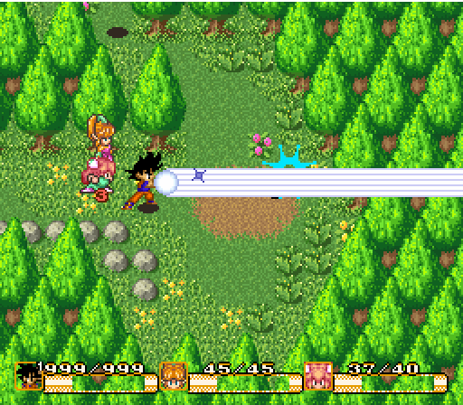

# secret of mana. with goku

  
  
  

**Secret of Goku** drops Goku into Secret of Mana's SNES action RPG. Explore its world, travel with companions, and solve problems with punches, flight, Instant Transmission, and wildly excessive amounts of ki.

**[Play in your browser](https://mikolalysenko.github.io/secret-of-goku/)** · **[Native downloads](https://github.com/mikolalysenko/secret-of-goku/releases)** · **[Teaser — coming soon](#teaser)**

  
  

## Play

Native releases are self-contained, include the ROM, and run offline. Download the build for your device, extract it, and launch the game:

| Device | Download |
| --- | --- |
| Windows PC | Windows x64 ZIP |
| Mac | macOS arm64 ZIP for Apple silicon; x64 ZIP for Intel |
| Linux PC | Linux x64 AppImage or tar.gz |
| Steam Deck | Steam Deck x64 AppImage or tar.gz |
| Bazzite | Bazzite x64 AppImage or tar.gz |

On Steam Deck or Bazzite, add the game to Steam in Desktop Mode and use the **Gamepad** controller template. The handheld builds start fullscreen. [Launch instructions and save locations](desktop/PLAYING.md).

The browser version supports keyboard, controllers, and touch. If prompted, select your own **Secret of Mana (USA)** ROM; it stays on your device.

## Controls

Controller labels use the Xbox / Steam Deck layout.

| Action | Keyboard | Controller |
| --- | --- | --- |
| Move | Arrow keys | D-pad / left stick |
| Punch, talk, confirm | X | A |
| Ki blast | C | X |
| Fly fast | Z + direction | B + direction |
| Menu / back | A | Y |
| Kamehameha | Hold Shift+C, release to fire | Hold LB+X, release |
| Instant Transmission | Shift+X | LB+A |
| Transform | Shift+Z | LB+B |
| Start | Space / Enter | Start / Menu |

[Full controls](desktop/PLAYING.md#controls).

## Teaser

Coming soon to YouTube — we're getting the teaser ready.

<!-- When the teaser is uploaded, replace the #teaser link above with its YouTube URL. -->

## About

This is a **vibe coded fan game**, made for fun and **not intended for commercial purposes**. It is unofficial and unaffiliated with the owners of Secret of Mana or Dragon Ball. [Credits and asset sources](CREDITS.md) · [Code license](LICENSE).

Developer notes, code summaries, and the changelog live in **[docs/agents/](docs/agents/README.md)**. Those documents contain spoilers.
